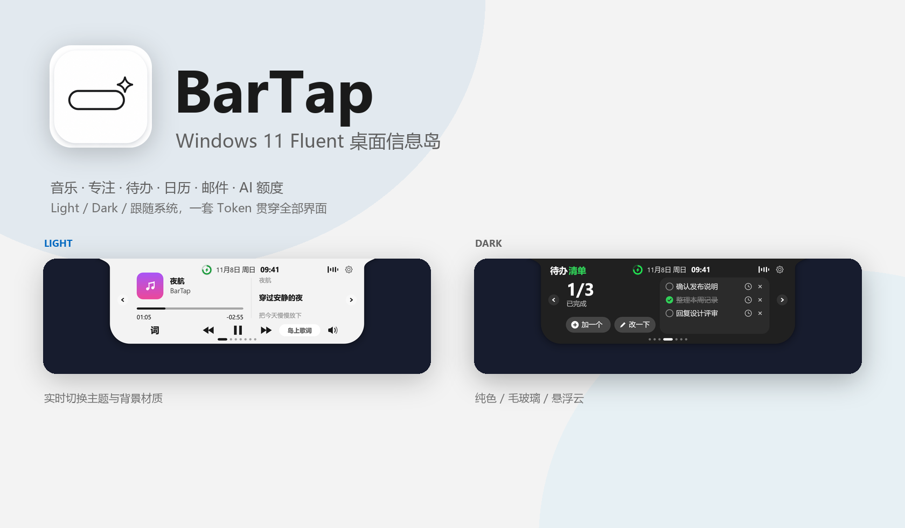
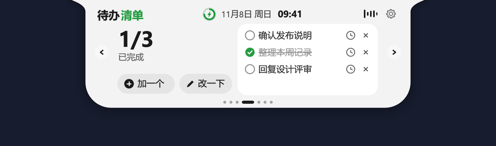
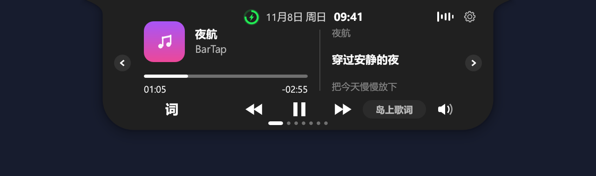
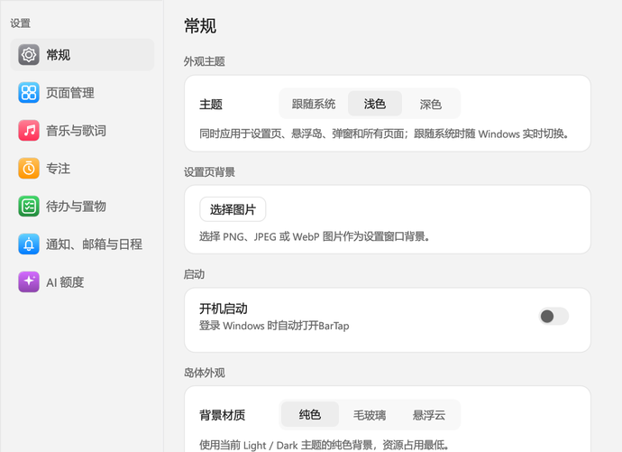
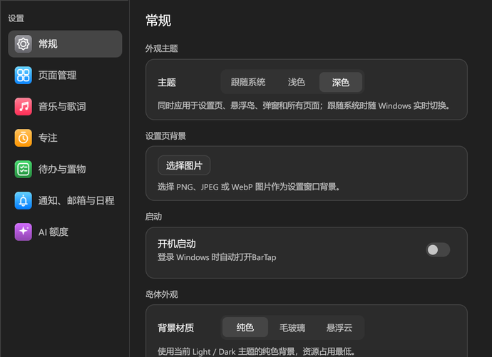

<div align="center">


# BarTap

**Windows 11 Fluent 桌面信息岛**

音乐、专注、待办、日历与 AI 额度，收在屏幕边缘的一座小岛里。


</div>



BarTap 是一个常驻屏幕边缘的 Windows 桌面信息岛。鼠标靠近时展开，离开后收起为一条细线或胶囊；切歌、看日程、记待办、看性能、查 AI 额度，都可以在岛内完成。

界面遵循 **Windows 11 Fluent Design / WinUI 3 视觉语言**，用 Rust 和 egui 实现。默认跟随 Windows 应用主题，支持 Light、Dark 与 System，全部界面共用同一套 Fluent Token。

> **当前版本：2.0.0（移除邮件，聚焦核心功能）**。Cargo 包名、库名和可执行文件为 `bartap` / `bartap.exe`；用户数据保存在 `%APPDATA%\BarTap`。

## 功能

| 模块 | 能做什么 |
| --- | --- |
| 音乐与歌词 | 通过 Windows 媒体会话读取播放信息，支持播放、暂停、切歌、进度、音量与同步歌词 |
| 专注 | 专注 / 休息计时，收起时也能查看进度，结束后提醒进入下一阶段 |
| 性能 | CPU、内存、网络吞吐与系统盘剩余空间，1 秒刷新，60 秒趋势 |
| 待办 | 单次提醒、每周指定日期重复、每天重复；到点提醒，下一次自动恢复 |
| 日历 | CalDAV、Exchange ActiveSync、飞书、钉钉、企业微信、iCloud 与 `.ics` 导入，合并会议提醒 |
| AI 额度 | Codex、Claude、Kimi、Grok Bot、Gemini、ZCode、WorkBuddy、DeepSeek 的额度与余额 |
| 置物架 | 拖入文件临时收集，点击打开或定位原文件，拖出到其他应用 |
| 剪贴板 | 找回最近复制的文字，常用内容可固定，历史保存在本机 |
| 通知与状态 | 微信 / QQ / Windows 通知、音量、电量、网络、蓝牙与输入语言提示 |

## 界面与主题

- **三种主题**：跟随系统、浅色、深色。默认跟随 Windows，系统切换后实时更新。
- **三种背景材质**：纯色、毛玻璃、悬浮云。颜色始终由当前主题决定。
- **统一控件**：按钮、开关、输入框、卡片、菜单、弹窗和岛内自绘内容共用 Fluent Token。
- **完整适配**：设置页、更新弹窗、额度连接窗、日历弹窗都支持 Light / Dark。
- **设置页背景**：可选择本地 PNG / JPEG / WebP 图片作为设置窗口背景，并调整遮罩深浅保证文字可读。
- **设置侧栏图标**：统一为 Apple 风格的圆角渐变底板与细线白色符号。
- **直接缩放**：展开岛后拖动右下角手柄调整大小，双击手柄恢复 100%。
- **极简命中**：视觉高度保持 4.5px，透明命中区扩大到 16px 高、左右各 6px，细线也好悬停。
- **可读性优先**：深色下不会出现白色输入框；浅色下不会出现黑底菜单或低对比文字。

| 浅色 | 深色 |
| --- | --- |
|  |  |

| 浅色设置 | 深色设置 |
| --- | --- |
|  |  |

完整设计规范见 [docs/DESIGN.md](docs/DESIGN.md)。

## 下载与安装

BarTap 2.0.0 为当前发布版本，将在 [BarTap Releases](https://github.com/fanfanhappy/BarTap/releases) 提供：

| 文件 | 用途 |
| --- | --- |
| `BarTap-Setup-v2.0.0-x64.exe` | 安装版，可选安装位置、桌面快捷方式和开机启动 |
| `BarTap-v2.0.0-windows-x64.zip` | 便携版，完整解压后运行 |
| `SHA256SUMS.txt` | 下载校验 |

安装包发布前，可先按下一节从源码构建。当前构建产物为 `bartap.exe`。

## 从源码构建

需要 Rust stable、MSVC C++ 构建工具和 Windows SDK。

```powershell
rustup default stable-x86_64-pc-windows-msvc
cargo build --locked --release --bin bartap
.\target\release\bartap.exe
```

运行测试：

```powershell
cargo test --locked --all-targets --features record -- --test-threads=1
```

开发时建议使用独立数据目录，避免覆盖日常设置：

```powershell
$env:BARTAP_DATA_DIR = Join-Path $env:TEMP 'bartap-development'
cargo run --locked --bin bartap
```

更多构建、测试与目录说明见 [开发指南](docs/DEVELOPMENT.md)。

## 数据与隐私

- 用户数据默认保存在 `%APPDATA%\BarTap`。
- 日历密码保存在 Windows 凭据管理器；独立会话使用 Windows DPAPI 加密。
- BarTap 没有自建的日程或账号上传后台。联网功能只会访问对应的服务商、歌词服务和 GitHub 更新接口。
- 详细说明见 [隐私与安全](docs/PRIVACY.md)。

## 项目结构

| 目录 / 文件 | 内容 |
| --- | --- |
| `src/app.rs`、`src/pages.rs` | 应用状态、悬浮岛与页面绘制 |
| `src/settings_theme.rs` | ThemeManager、Fluent Token 与系统主题监听 |
| `src/skin_paint.rs` | 岛体内容的 Light / Dark 投影 |
| `src/calendar*` | 日历 |
| `src/quota*` | AI 额度与账号连接 |
| `src/native.rs`、`src/system.rs` | Windows 原生窗口、输入与系统事件 |
| `docs/` | 使用、隐私、设计规范与开发文档 |
| `installer/`、`scripts/` | 安装、卸载与打包 |

## 参与

BarTap 目前是个人维护项目，不设公开的贡献流程。欢迎通过 [Issues](https://github.com/fanfanhappy/BarTap/issues) 反馈可复现的问题、兼容性差异和文档错误。

提交问题前，请先去掉账号、Cookie、授权码和私人日程等敏感信息。

## 许可

BarTap 的代码按 [MIT License](LICENSE) 发布。BarTap 的版权声明与许可全文见 [LICENSE](LICENSE)；原始代码的 MIT 版权声明、第三方组件、字体、图标与素材的来源和许可见 [THIRD_PARTY_NOTICES.txt](THIRD_PARTY_NOTICES.txt) 与 [依赖说明](docs/DEPENDENCIES.md)。
