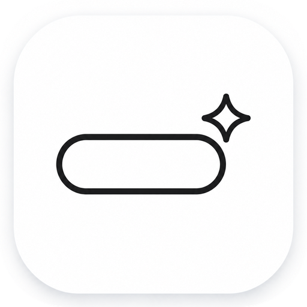
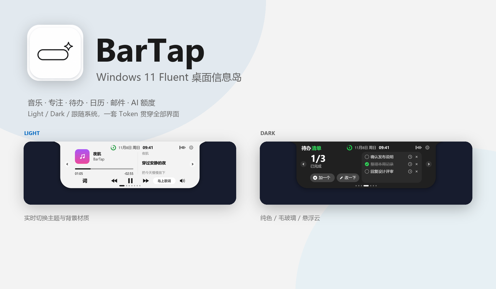
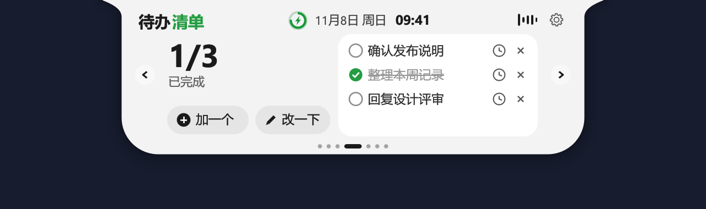
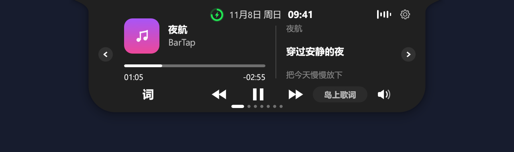
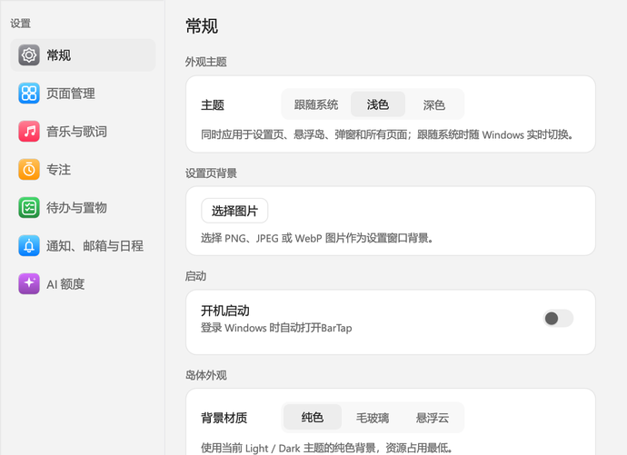
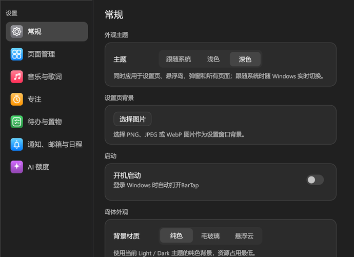

<div align="center">



# BarTap

**A Windows 11 Fluent desktop information island**

Music, focus, tasks, calendar and AI quotas — collected at the edge of your screen.


</div>



BarTap is an always-available desktop island for Windows. Hover near the top edge to expand it; move away and it folds back into a slim bar or capsule. Play music, check your calendar, add a task, copy a verification code or inspect an AI quota without leaving the desktop.

The interface follows the **Windows 11 Fluent Design / WinUI 3 visual language**, implemented with Rust and egui. It follows the Windows app theme by default and supports Light, Dark and System, with every surface sharing the same Fluent design tokens.

> **Current version: 2.0.0 (mail removed, focused on core features)**. The Cargo package, library and executable are `bartap` / `bartap.exe`; user data is stored in `%APPDATA%\BarTap`.

## Features

| Module | What it does |
| --- | --- |
| Music & lyrics | Windows media session playback, transport controls, seek, volume and synced lyrics |
| Focus | Focus / break timer with a collapsed progress view and completion reminder |
| Performance | CPU, memory, network throughput and system-drive free space; 1-second refresh with 60-second trends |
| Tasks | One-off reminders, weekly recurrence and daily recurrence |
| Calendar | CalDAV, Exchange ActiveSync, Feishu, DingTalk, WeCom, iCloud and `.ics` import |
| AI quotas | Codex, Claude, Kimi, Grok Bot, Gemini, ZCode, WorkBuddy and DeepSeek balances |
| Shelf | Drag files into a temporary shelf; open, reveal or drag them out |
| Clipboard | Recent text history with pinned entries, stored locally |
| Notifications | WeChat / QQ / Windows notifications, volume, battery, network, Bluetooth and input language |

## Themes and appearance

- **Three theme modes**: System, Light and Dark. System follows Windows and updates live.
- **Three background materials**: Solid, Glass and Fluid. Colors always come from the active theme.
- **One component language**: buttons, switches, inputs, cards, menus, dialogs and custom-drawn island content share Fluent tokens.
- **Full coverage**: settings, update dialog, quota connection and calendar dialogs all support Light and Dark.
- **First-run guide**: three screens for appearance, island form and common pages instead of dropping into settings.
- **Settings background**: choose a local PNG / JPEG / WebP image for the settings window and adjust a readability scrim.
- **Settings sidebar icons**: unified Apple-style rounded gradient tiles with fine white line symbols.
- **Direct resize**: expand the island and drag the bottom-right handle; double-click the handle to reset to 100%.
- **Minimal hit area**: the visual line stays 4.5px high while a transparent hit area expands to 16px with 6px on each side.
- **Readability first**: no white inputs on dark surfaces and no dark menus or low-contrast text on light surfaces.

| Light | Dark |
| --- | --- |
|  |  |

| Light settings | Dark settings |
| --- | --- |
|  |  |

See [docs/DESIGN.md](docs/DESIGN.md) for the full design standard.

## Download and install

BarTap 2.0.0 is the current release. [BarTap Releases](https://github.com/fanfanhappy/BarTap/releases) will provide:

| File | Purpose |
| --- | --- |
| `BarTap-Setup-v2.0.0-x64.exe` | Installer with install location, shortcut and autostart options |
| `BarTap-v2.0.0-windows-x64.zip` | Portable build |
| `SHA256SUMS.txt` | Download checksums |

Until the installer is published, build from source with the instructions below. The current build artifact is `bartap.exe`.

## Build from source

Requirements: Rust stable, MSVC C++ build tools and the Windows SDK.

```powershell
rustup default stable-x86_64-pc-windows-msvc
cargo build --locked --release --bin bartap
.\target\release\bartap.exe
```

Run the tests:

```powershell
cargo test --locked --all-targets --features record -- --test-threads=1
```

Use an isolated data directory during development:

```powershell
$env:BARTAP_DATA_DIR = Join-Path $env:TEMP 'bartap-development'
cargo run --locked --bin bartap
```

See [docs/DEVELOPMENT.md](docs/DEVELOPMENT.md) for project structure and test details.

## Data and privacy

- User data is stored in `%APPDATA%\BarTap`.
- Calendar passwords use Windows Credential Manager; standalone sessions use Windows DPAPI.
- BarTap has no self-hosted calendar or account upload backend. Network features only contact the relevant providers, lyric services and the GitHub update endpoint.
- See [docs/PRIVACY.md](docs/PRIVACY.md) for details.

## Project layout

| Path | Contents |
| --- | --- |
| `src/app.rs`, `src/pages.rs` | App state, island shell and page rendering |
| `src/settings_theme.rs` | ThemeManager, Fluent tokens and system theme detection |
| `src/skin_paint.rs` | Light / Dark projection for island content |
| `src/calendar*` | Calendar |
| `src/quota*` | AI quota providers and account connections |
| `src/native.rs`, `src/system.rs` | Windows-native window, input and system events |
| `docs/` | Usage, privacy, design and development docs |
| `installer/`, `scripts/` | Installer, uninstaller and packaging |

## Contributing

BarTap is currently a personal project without a public contribution process. Please use [Issues](https://github.com/fanfanhappy/BarTap/issues) for reproducible bugs, compatibility differences and documentation errors.

Remove account details, cookies, credentials and private calendar data before posting.

## License

BarTap is released under the [MIT License](LICENSE). The BarTap copyright notice and license text are in [LICENSE](LICENSE); the original code's MIT copyright notice and third-party component, font, icon and asset licenses are in [THIRD_PARTY_NOTICES.txt](THIRD_PARTY_NOTICES.txt) and [docs/DEPENDENCIES.md](docs/DEPENDENCIES.md).
